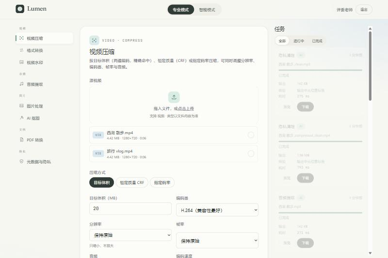
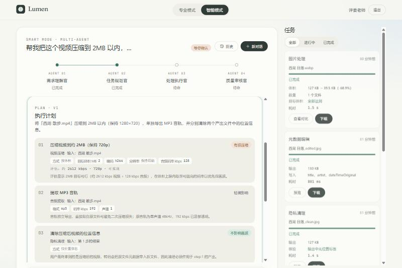
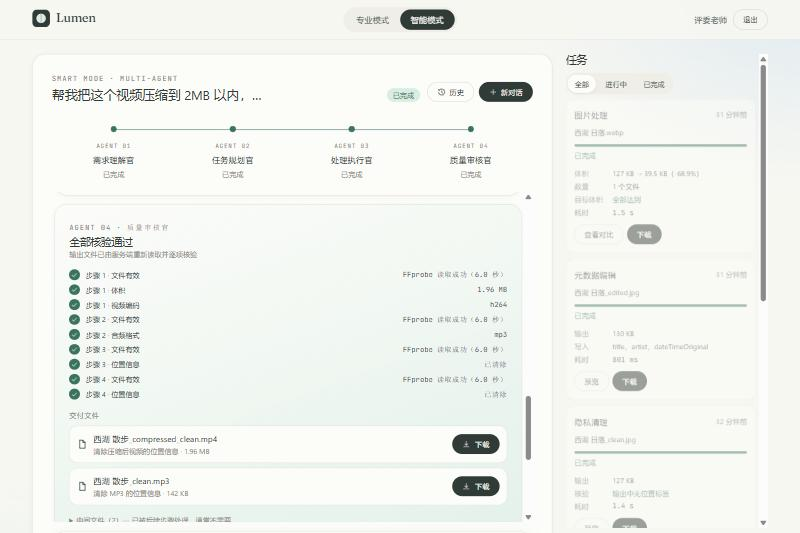

# Lumen · 流明智媒

> AI 驱动的创作者媒体工作台。专业模式让你精确掌控每个参数；智能模式让你用一句话描述想要的结果，由四个 Agent 理解、规划，经你确认后执行，并独立核验结果。两种模式共用同一套真实的处理引擎。


| 专业模式 | 智能模式 · 计划确认 | 智能模式 · 质量审核 |
|---|---|---|
|  |  |  |

## 能力

| 领域 | 能力 | 引擎 |
|---|---|---|
| 视频 | 按目标体积压缩（两遍编码，提交前评估可行性）/ CRF / 指定码率；H.264 / H.265；分辨率、帧率、音频参数；格式转换（MP4/MOV/WebM/MKV/GIF）；图片水印 | FFmpeg |
| 音频 | 从视频中提取 MP3 / AAC / M4A / WAV / FLAC，可设置码率、采样率、声道 | FFmpeg |
| 图片 | 批量压缩（JPG/WebP/AVIF 可按目标体积压缩）、改尺寸、转格式；处理前后对比；AI 抠图 | ImageMagick · rembg |
| 文档 | 多张图片合并为 PDF；PDF 转图片 | ImageMagick · Ghostscript |
| 隐私 | 查看元数据、编辑标题/作者/拍摄时间/GPS（按格式的真实能力开放字段）；一键清除位置信息或全部元数据，并独立核验 | ExifTool · FFmpeg |
| 文档 · V2 | Word / Excel / 网页转 PDF，上传前校验文档结构，转换后核验 PDF | LibreOffice · Chromium · PDFBox |
| 材料规范官 · V2 | 粘贴比赛通知自动提取材料规范；拖入整个文件夹后自动匹配到人、检查、修正，并按模板生成交付包 | DeepSeek · Apache POI · 上述引擎 |
| 学习播放器 · V2 | 教学视频 → 随播放生长的知识图谱；讲到代码时，代码出现在浏览器沙盒中，可以直接运行 | 阿里云百炼 · RapidOCR · DeepSeek · Pyodide · Monaco |
| 智能模式 | 需求理解 → 任务规划 → **用户确认** → 执行 → 质量审核；过程实时可见，可断线续传 | DeepSeek |

## 快速开始（Windows 10 / 11）

```powershell
# 1. 检查环境（只读）
powershell -ExecutionPolicy Bypass -File scripts\check-environment.ps1

# 2. 一键启动（首次会自动创建 .env、构建前后端；之后约 10 秒）
powershell -ExecutionPolicy Bypass -File scripts\start-windows.ps1

# 3. 停止
powershell -ExecutionPolicy Bypass -File scripts\stop-windows.ps1
```

启动后打开 **http://localhost:8080**。依赖安装、DeepSeek Key 配置和常见问题见 [docs/deployment.md](docs/deployment.md)。

> **关于密钥**：DeepSeek API Key 只保存在本机的 `.env` 文件中（已被 `.gitignore` 排除），只由后端读取，**不会**出现在前端、日志或仓库里。仓库只提供带占位符的 [`.env.example`](.env.example)。

## 技术栈

- 后端：Spring Boot 3.5 · Java 17 · JPA · Flyway 迁移 · SQLite（本地/演示）/ PostgreSQL 16（生产）· Spring Security（BCrypt + JWT）· SSE
- 前端：Vue 3 · TypeScript · Vite · Pinia · Vue Router · GSAP
- AI：DeepSeek（OpenAI 兼容接口，工具调用 + 流式输出），四个 Agent，版本化的 Prompt 与 SKILL
- 测试：JUnit 5 · MockMvc · jqwik，全部使用真实媒体文件与真实工具

## 文档

| 文档 | 内容 |
|---|---|
| [docs/architecture.md](docs/architecture.md) | 架构图、统一数据流、多 Agent 状态机、安全边界 |
| [docs/api-contract.md](docs/api-contract.md) | 全部 REST / SSE 接口 |
| [docs/backend-audit.md](docs/backend-audit.md) | 原始后端的安全审计与整改对照 |
| [docs/test-report.md](docs/test-report.md) | 真实执行的测试结果 |
| [docs/deployment.md](docs/deployment.md) | Windows 本地部署与排错 |
| [docs/demo-guide.md](docs/demo-guide.md) | 面向老板与评委的演示手册 |

## 开发

```bash
# 后端（需要 JDK 17+；首次运行 Maven Wrapper 会自动下载 Maven）
cd backend
./mvnw spring-boot:run          # Windows: mvnw.cmd spring-boot:run
./mvnw test                     # 76 个测试；真实模型测试需另加 -Dtest=AiLiveTests -Dai.live=true

# 前端（需要 Node 18+）
cd frontend
npm ci
npm run dev                     # http://localhost:5173，/api 代理到 8080
npm run build
```

## 目录

```
backend/    Spring Boot 服务（媒体引擎、任务引擎、多 Agent、SKILL 与 Prompt）
frontend/   Vue 3 前端（品牌首页 + 双模式工作台）
docs/       架构、接口、审计、测试、部署、演示
scripts/    Windows 环境检查 / 一键启动 / 停止
assets/     截图
```
